# NEON SKY — демка в духе ZX Spectrum на чистом Python

Демо-программа с псевдографикой и музыкой: абстрактные узоры, плазма,
туннель, огненный столб, векторный тор и бегущие строки — всё это живет
под оригинальный чиптюн, сгенерированный кодом. Без единой сторонней
библиотеки: только стандартная библиотека Python 3.9+.

```
python3 -m spectrum preview     # демка с музыкой в браузере
python3 -m spectrum play        # то же самое прямо в терминале
```

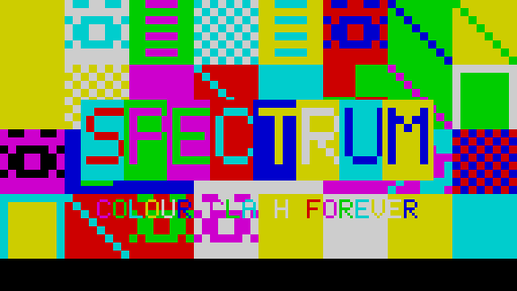

## Что внутри

Демка — это 11 сцен подряд (~151 секунда под трек на 70 секунд, который
зацикливается), каждая сцена реагирует на музыку: ударные дёргают
палитру, бас раздувает солнце, доли качают растры.

| Сцена    | Что показывает                                  | Кадр |
|----------|-------------------------------------------------|------|
| loader   | пародия на загрузку с кассеты: мигающая рамка, счётчик, прогресс | 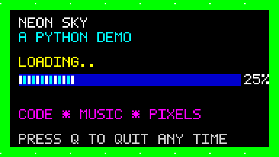 |
| logo     | хромированный титул «NEON SKY» над ночным горизонтом | 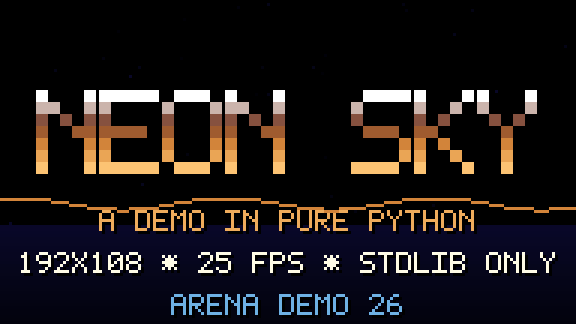 |
| plasma   | классическая плазма из сумм синусов             | 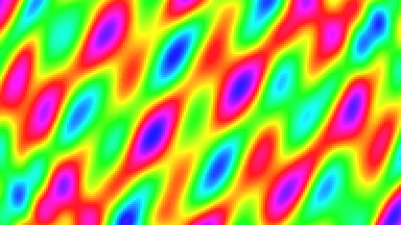 |
| mode7    | «COLOUR CLASH»: мозаика из символов UDG с атрибуными конфликтами, как на реальном Spectrum |  |
| tunnel   | бесконечный туннель с медной текстурой          | 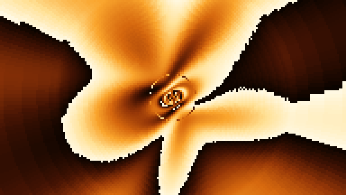 |
| scroller | медный логотип, растер-бары и бегущая строка на русском | 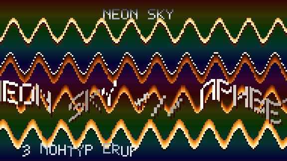 |
| vector   | каркасный тор, вращающийся в звездном поле      | 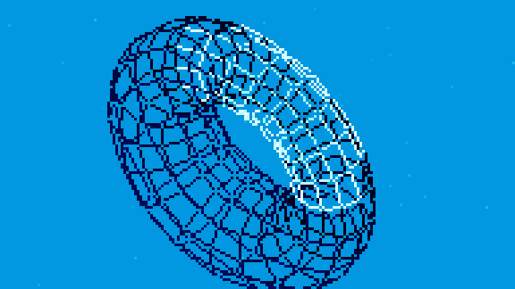 |
| road     | synthwave-дорога: разрезанное солнце и неоновая сетка | 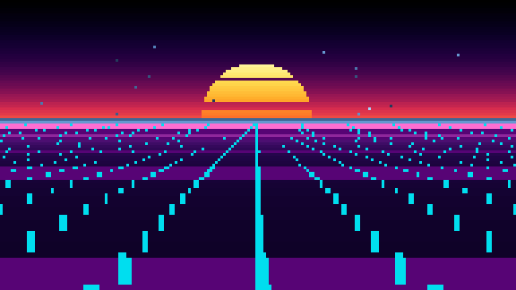 |
| copper   | толстые волнистые copper-бары с градиентом      | 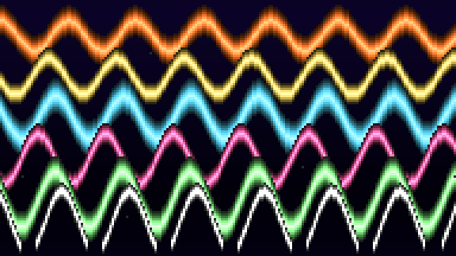 |
| fire     | огонь doom-fire: тепло поднимается и остывает   | 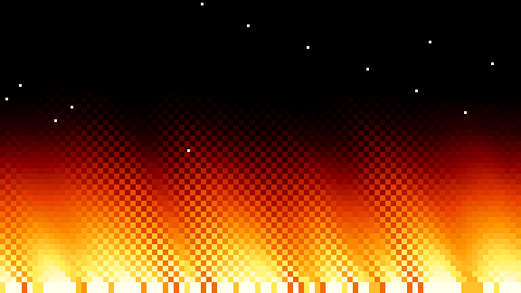 |
| finale   | титры и «THE END»                               | 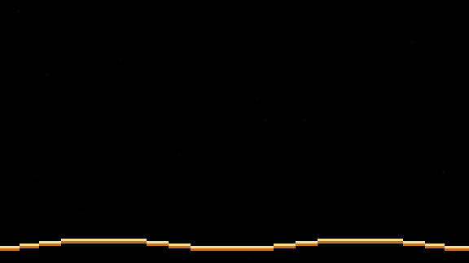 |

## Запуск

```bash
python3 -m spectrum preview [--port 8000]   # HTTP-сервер: картинка + WAV в браузере
python3 -m spectrum play [--scenes plasma,fire] [--speed 1.5] [--no-audio]
python3 -m spectrum shot 42.0 frame.png --scale 3   # один кадр в PNG
python3 -m spectrum wav neon-sky.wav        # саундтрек отдельно
python3 -m spectrum scenes                  # список сцен и их тайминги
python3 -m unittest discover -s tests       # тесты
```

`play` рисует в терминал полублочными символами `▀` (truecolor / 256 / 16
цветов — по возможностям терминала) и параллельно пытается запустить
системный плеер для WAV (aplay, ffplay, paplay, mpv, afplay; на Windows —
winsound). Если плеера нет — демка идёт без звука: тогда лучше
`preview`, браузер озвучит её сам. Выход из `play` — клавиша `q`.

## Как это устроено

* **Кадр** — bytearray 192×108 байт, по одному индексу палитры на
  пиксель (всего 20 736 пикселей — как раз атмосфера Spectrum). Кадр
  рисуется ~4 мс, палитра из 256 цветов подставляется одной операцией
  `b"".join` по таблице триплетов, дальше PNG или ANSI в терминал.
* **Палитры** (`palettes.py`) — градиенты по контрольным точкам,
  циклический сдвиг, смешивание; у каждой сцены своя раскладка из
  диапазонов индексов (небо/солнце/сетка/звёзды), чтобы пиксельный цикл
  только выбирал индекс.
* **Шрифт** (`font.py`) — bitmap 5×8, латиница, кириллица и `♪ ♥ →`.
* **Музыка** (`synth.py`, `score.py`, `songs.py`) — трек «NEON SKY»
  описан паттернами в нотах (`c#4:4` = нота и длина в шагах),
  компилируется в события и синтезируется в стерео 22 кГц: пульс-волны
  с огибающей, шумовые ударные, эхо и мягкий клиппинг. Рендер трека —
  ~23× быстрее реального времени.
* **Синхронизация** (`music_sync.py`) — из партитуры считаются 16
  логарифмических полос 45 Гц…6 кГц и затухающие импульсы
  kick/snare/hat/bass; сцены читают их каждый кадр и дышат в такт.
* **Таймлайн** (`stage.py`) — сценам назначены durata в тактах, между
  ними фейд в черноту; `locate(t)` говорит, кто на экране, и вся демка
  детерминирована: один и тот же `t` даёт один и тот же кадр.
* **Браузер** (`server.py`) — страницы нет в файлах: HTML/JS отдаёт
  сам сервер, кадры приходят PNG-ами `/frame.png?t=…`, звук —
  `/music.wav`, а JS держит их в одной фазе по `performance.now()`.

## Структура

```
spectrum/
  font.py palettes.py canvas.py png.py wav.py pacer.py console.py
  synth.py score.py songs.py music_sync.py stage.py audio.py server.py
  __main__.py
  effects/            # сцены
    base.py           #   базовый класс, таблицы синусов, звездное поле, хром-текст
    loader.py logo.py plasma.py mode7.py tunnel.py scroller.py
    vector.py road.py copper.py fire.py finale.py
tests/                # unittest: шрифт, кадр, PNG, партитура, синтез, сцены
assets/shots/         # кадры для этого README
```

Никаких зависимостей: ни numpy, ни pygame, ни Pillow — только математика,
`bytearray` и любовь к 1987 году.
